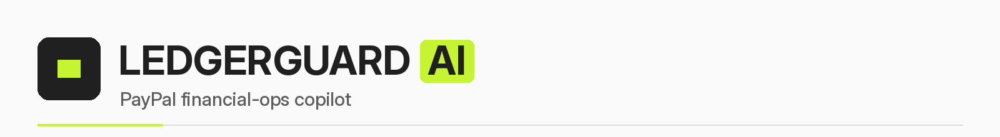
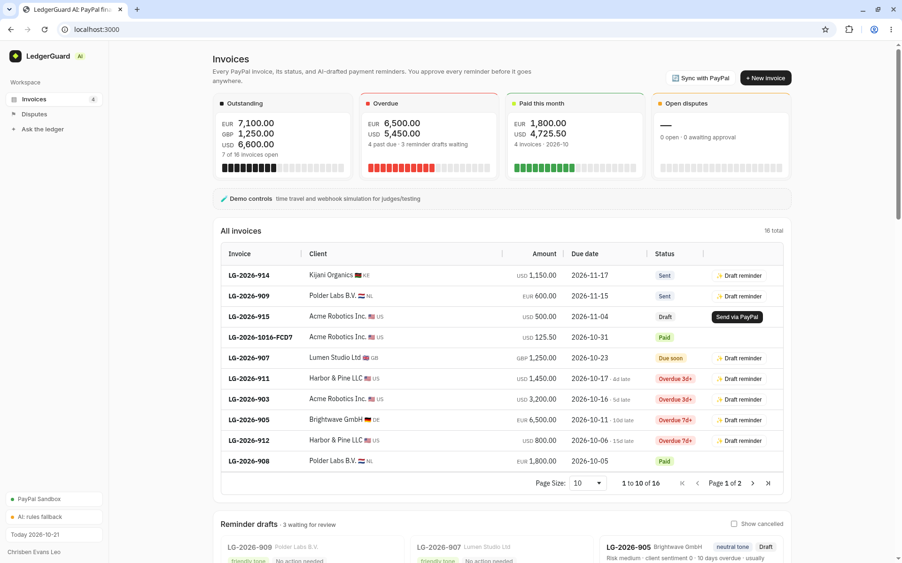
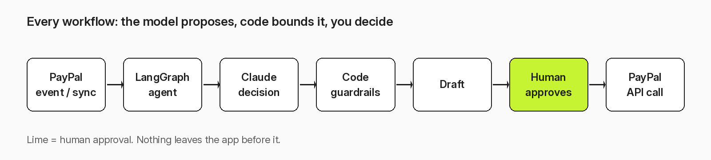
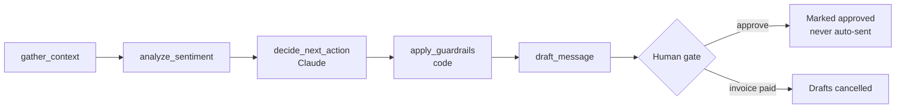
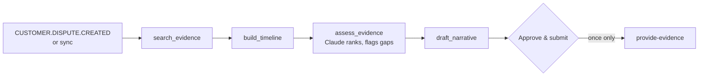
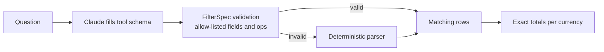
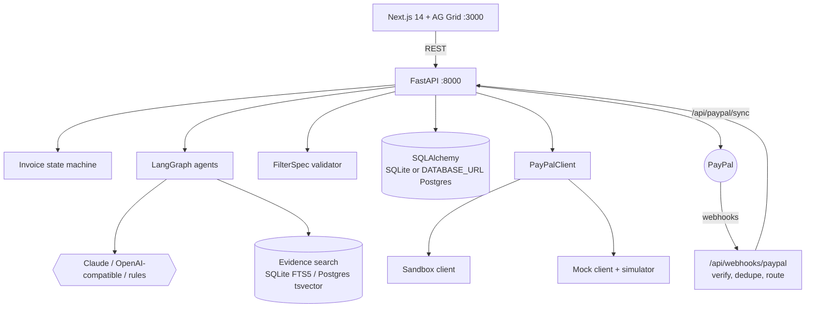
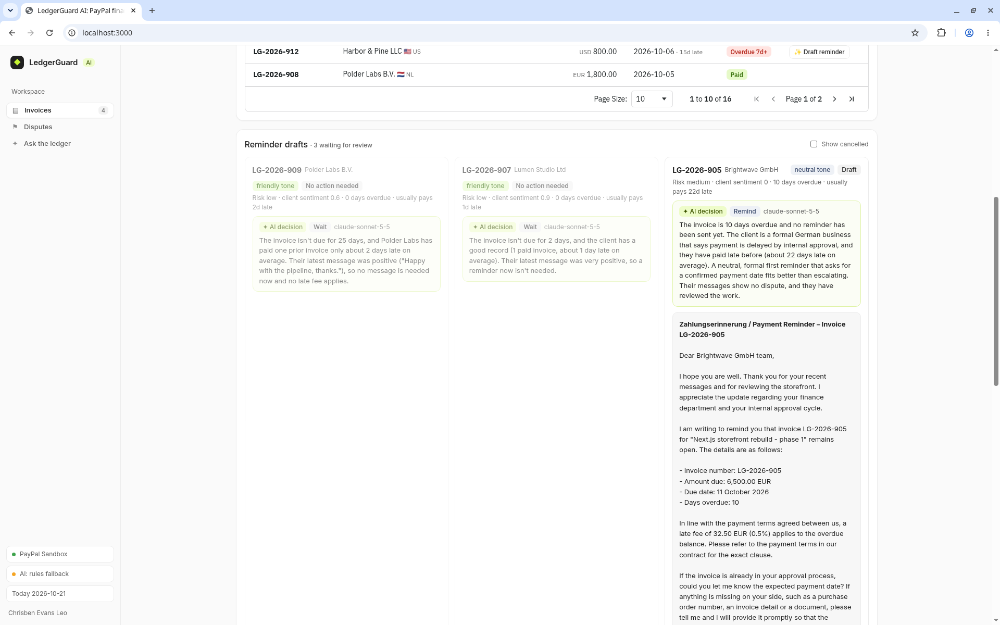
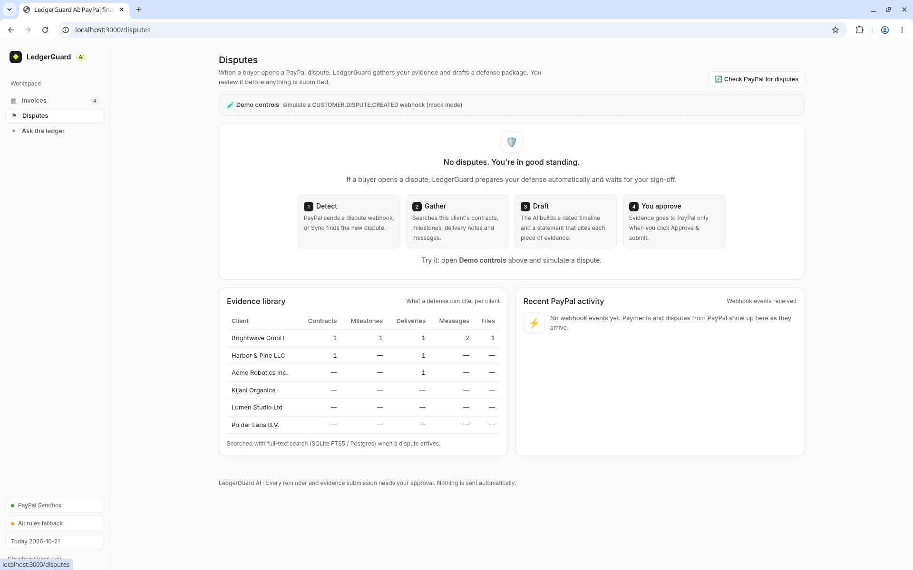
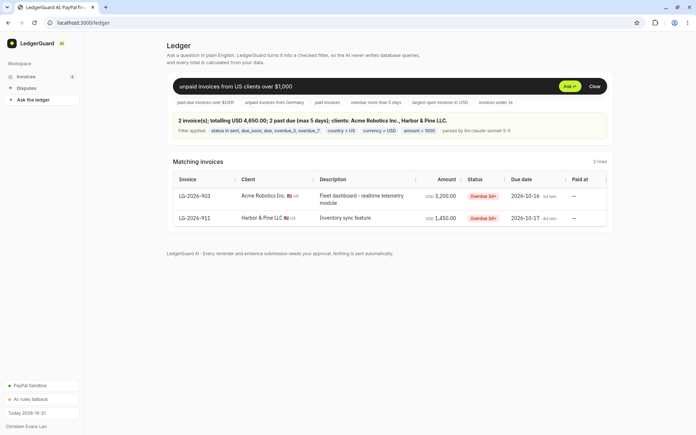

# LedgerGuard AI



An agentic PayPal copilot for freelancers and cross-border micro-SMEs. It chases late invoices, builds chargeback defenses, and answers "who owes me what?" in plain language. The model proposes; code bounds it; a human approves every step that leaves the app.

Built by Chrisben Evans Leo (Nairobi) for the PayPal AI Hackathon, 2026. Live demo: [DEMO_URL]. Video: [YOUTUBE_URL].



## Behaviour

Three workflows share one invoice ledger.

**Invoice chaser.** Invoices move through a state machine: `draft → sent → due_soon → due → overdue_3 → overdue_7 → paid`. A LangGraph agent reads the client's country, payment history, message sentiment, and prior reminders. Claude picks the next action (wait, remind, offer a split, offer Pay Later, escalate), the tone, and a late fee. Code then applies the guardrails and writes a draft. Drafts are never sent.

**Dispute defense.** A `CUSTOMER.DISPUTE.CREATED` event triggers evidence search, a timeline, milestone refs, and a statement that cites evidence ids. Claude ranks evidence by relevance and flags gaps. Evidence reaches PayPal only after you click Approve.

**Conversational ledger.** A question becomes a JSON filter spec. The server validates it against an allow-list. The LLM never writes SQL. Totals are computed exactly from matching rows, per currency.



## Agents







With `ANTHROPIC_API_KEY` set, Claude runs through the `anthropic` SDK (`LLM_MODEL`, default `claude-sonnet-5-5`). Otherwise an OpenAI-compatible endpoint is used. With no key, a deterministic rules engine runs. Every structured result is validated again on the server.

## Layout



| Path | Role |
|---|---|
| `backend/app/main.py` | FastAPI routes, webhooks, sync, dev clock and simulators |
| `backend/app/agents.py` | LangGraph reminder and dispute agents, guardrails |
| `backend/app/llm.py` | Claude, OpenAI-compatible, or deterministic provider |
| `backend/app/paypal.py` | sandbox and mock PayPal clients, token cache, backoff |
| `backend/app/state_machine.py` | invoice lifecycle states |
| `backend/app/filters.py` | FilterSpec allow-list and exact totals |
| `backend/app/evidence_search.py` | FTS5 / tsvector evidence search |
| `backend/app/db.py`, `seed.py` | SQLAlchemy models, demo data |
| `backend/tests/` | state machine, filters, guardrails, webhooks, PayPal client |
| `frontend/app/` | `/` chaser, `/disputes`, `/ledger` |
| `frontend/components/` | AG Grid, nav, UI kit |
| `render.yaml` | two-service Render blueprint |
| `docs/` | Devpost write-up, demo script, README assets |

## Screens

Invoice chaser with agent drafts, decision, rationale, and guardrail notes:



Dispute defense with ranked evidence and timeline:



Ledger question, validated spec, and exact summary:



## Local

Python 3.11+ and Node 20+. Mock mode needs no credentials.

```bash
cp .env.example .env
./run-backend.sh     # venv, seed, http://localhost:8000 (docs at /docs)
./run-frontend.sh    # http://localhost:3000
./run-tests.sh       # 32 tests
```

Reset the demo data:

```bash
cd backend && .venv/bin/python -m app.seed
```

Time travel and simulation in mock mode:

```bash
curl -X POST localhost:8000/api/dev/clock/advance -H 'content-type: application/json' -d '{"days":7}'
curl -X POST localhost:8000/api/reminders/run
curl -X POST localhost:8000/api/ledger/query -H 'content-type: application/json' -d '{"question":"past-due invoices over $1000"}'
```

## PayPal

Sandbox mode turns on when `PAYPAL_CLIENT_ID` and `PAYPAL_CLIENT_SECRET` are both set. `PAYPAL_MODE=mock|sandbox` forces one.

| Surface | Calls |
|---|---|
| Invoicing v2 | `POST /v2/invoicing/invoices`, `POST /v2/invoicing/invoices/{id}/send`, `GET /v2/invoicing/invoices/{id}` |
| Disputes | `GET /v1/customer/disputes`, `GET /v1/customer/disputes/{id}`, `POST /v1/customer/disputes/{id}/provide-evidence` |
| Webhooks | `INVOICING.INVOICE.PAID`, `PAYMENT.CAPTURE.COMPLETED`, `CUSTOMER.DISPUTE.CREATED` |
| Verification | `POST /v1/notifications/verify-webhook-signature`, de-dupe by event id |

OAuth2 tokens are cached. 429 and 5xx retry with exponential backoff and jitter, honouring `Retry-After`. Writes carry a `PayPal-Request-Id` idempotency key.

No public URL? `POST /api/paypal/sync` polls open invoices. `PAID` or `MARKED_AS_PAID` goes through the same mark-paid path as the webhook and cancels pending drafts. New disputes get a defense package.

Deploy: Render → New → Blueprint. `render.yaml` creates `ledgerguard-api` and `ledgerguard-web`; secrets are prompted, never committed. Default is `PAYPAL_MODE=mock`.

## Rules

1. Nothing is sent without human approval. Reminders are drafts only.
2. Dispute evidence goes to PayPal only from the approval endpoint, once.
3. Late fee is capped at 1.5% and only from 7+ days overdue.
4. The fee is dropped when a split or Pay Later is offered.
5. Fee amounts are computed by code, never by the model.
6. Escalation is allowed only from 14+ days overdue.
7. Before the due date: no firm tone, plain reminder only.
8. Split installments are exact and sum to the invoice total.
9. A draft mentioning a fee the policy disallowed is replaced with a template.
10. Evidence ids must exist; relevance scores are clamped to 0–1.
11. Ledger questions become a validated JSON filter, never SQL. Numbers are never generated by the LLM.

## Not yet

- Webhooks against a public URL: not yet exercised end to end. Sync polling is the tested path.
- Real buyer payment and live disputes in the sandbox: untested.
- Docker (`docker compose up --build`) and Postgres via `DATABASE_URL`: untested.
- Render free plan uses SQLite on an ephemeral disk; the demo re-seeds on every boot.
- Seeded invoices carry synthetic PayPal ids; live sandbox calls need new invoices.

## Docs

- [Devpost write-up](docs/DEVPOST.md)
- [Demo script](docs/DEMO_SCRIPT.md)
- [Render blueprint](render.yaml)
- [Environment template](.env.example)
- API docs: `http://localhost:8000/docs`

MIT © 2026 Chrisben Evans Leo. See [LICENSE](LICENSE).
