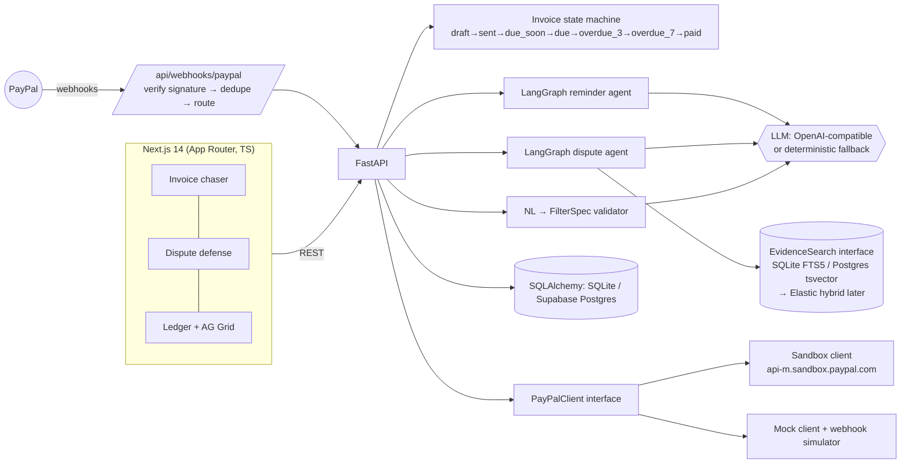

# LedgerGuard AI

**An agentic PayPal financial-ops copilot for freelancers and cross-border micro-SMEs.**
Built by **Chrisben Evans Leo** (Nairobi) for the PayPal AI Hackathon on Devpost, 2026.

A Kenyan developer billing clients in the US and EU loses time and money to three things: chasing late invoices, defending chargebacks, and answering "who owes me what?" LedgerGuard AI handles all three. A human approves every step that leaves the app.

| Workflow | PayPal APIs | AI |
|---|---|---|
| **Invoice chaser** | `POST /v2/invoicing/invoices`, `POST /v2/invoicing/invoices/{id}/send`, webhooks `INVOICING.INVOICE.PAID`, `PAYMENT.CAPTURE.COMPLETED` | LangGraph agent: gather context → sentiment → tone policy → draft (friendly / neutral / firm with an optional late fee). It only writes drafts and never sends them. |
| **Dispute defense** | webhook `CUSTOMER.DISPUTE.CREATED`, `GET /v1/customer/disputes/{id}`, `POST /v1/customer/disputes/{id}/provide-evidence` (only after the user clicks Approve) | LangGraph agent: full-text evidence search → chronological timeline → milestone refs → narrative statement |
| **Conversational ledger** | data from the invoices above | Natural language → JSON filter spec that the server validates. The LLM never writes SQL. Summary figures are computed exactly from the matching rows. |

Also included: OAuth2 client credentials with token caching, exponential backoff with jitter on 429/5xx (honours `Retry-After`), `PayPal-Request-Id` idempotency keys, webhook signature verification via `/v1/notifications/verify-webhook-signature`, and webhook de-duplication by event id.

## Architecture



## Quick start (mock mode: no credentials needed)

```bash
cp .env.example .env
./run-backend.sh     # creates the venv, seeds the demo DB, serves http://localhost:8000 (docs at /docs)
./run-frontend.sh    # serves http://localhost:3000
./run-tests.sh       # pytest (state machine, filters, webhooks, PayPal client backoff/verification)
```
You need Python 3.11+ and Node 20+. Docker alternative: `docker compose up --build`.
To reset the demo data: `cd backend && .venv/bin/python -m app.seed`.

## Environment variables
| Var | Purpose |
|---|---|
| `DATABASE_URL` | Default `sqlite:///./ledgerguard.db`. For Supabase, use `postgresql+psycopg://...` and `pip install psycopg[binary]`. |
| `PAYPAL_CLIENT_ID`, `PAYPAL_CLIENT_SECRET` | Sandbox REST app credentials. **Sandbox mode turns on automatically when both are set.** |
| `PAYPAL_MODE` | Leave blank for auto. Set `mock` or `sandbox` to force a mode. |
| `PAYPAL_WEBHOOK_ID` | The webhook ID from the developer dashboard. Signature verification needs it. |
| `PAYPAL_BASE_URL` | Default `https://api-m.sandbox.paypal.com` |
| `MERCHANT_EMAIL`, `MERCHANT_NAME` | Invoicer details. The email must be the sandbox business account. |
| `OPENAI_API_KEY`, `OPENAI_BASE_URL`, `LLM_MODEL` | Any OpenAI-compatible endpoint. Leave the key blank to use the deterministic fallback. |
| `NEXT_PUBLIC_API_URL` | Where the frontend finds the API |

## Demo walkthrough (mock mode)
1. **Invoice chaser** (`/`): create and send an invoice; it gets a mock `INV2-…` id and its status becomes `sent`. Click **+7 days** to advance the clock and watch the states move to `due_soon`, then `due`, then `overdue_3`, then `overdue_7`.
2. Click **Draft reminder** (or **Run chaser agent**). Harbor & Pine (paid late before, sent "cash flow problem" messages) gets a *firm* draft with a 1.5% late-fee option. Lumen Studio (warm, prompt payer) gets a friendly one. The agent's trace and reasoning are shown next to each draft.
3. Click **Simulate paid**. This posts an `INVOICING.INVOICE.PAID` event to the webhook handler, which marks the invoice `paid` and cancels its pending reminder drafts.
4. **Dispute defense** (`/disputes`): open a dispute on the Brightwave GmbH invoice. This posts a `CUSTOMER.DISPUTE.CREATED` event. The handler GETs the dispute and searches Brightwave's evidence (signed SOW, milestone, approval, delivery, acceptance email). The agent then builds a timeline, milestone refs and a statement with citations. Nothing is sent until you click **Approve & submit evidence**, which calls provide-evidence.
5. **Ledger** (`/ledger`): ask *"past-due invoices over $1000"*. The AG Grid filters, the validated spec is shown, and the summary is computed exactly from the data.

## Key endpoints
`GET /api/invoices` · `POST /api/invoices` · `POST /api/invoices/{id}/send` · `POST /api/invoices/{id}/reminders` · `POST /api/reminders/run` · `POST /api/reminders/{id}/approve` · `POST /api/webhooks/paypal` · `GET /api/disputes` · `POST /api/disputes/{id}/submit-evidence` · `POST /api/ledger/query` · `POST /api/ledger/filter`
Dev endpoints: `POST /api/dev/clock/advance {days}` · `/api/dev/clock/reset` · `/api/dev/simulate/payment {invoice_id, event_type}` · `/api/dev/simulate/dispute {invoice_id, reason, message}`

## How the AI is used (agentic, inside guardrails)
**Provider:** Anthropic Claude through the official `anthropic` SDK is selected automatically when `ANTHROPIC_API_KEY` is set. The default model is `claude-sonnet-5-5`; override it with `LLM_MODEL`. Otherwise an OpenAI-compatible endpoint is used, and with no key a deterministic rules engine runs instead. Structured output uses Claude tool use with a JSON schema, and the server validates every result again.

**Invoice chaser** (LangGraph: `gather_context → analyze_sentiment → decide_next_action → apply_guardrails → draft_message`)
- Claude chooses the **next action** (wait / remind / offer a split payment / offer Pay Later / escalate), the **tone**, a **late-fee percentage**, and a short **rationale**, all grounded in the client's country, payment history, the sentiment of their recent messages and any prior reminders.
- **Guardrails are enforced in code** whatever the model proposes:
  - The late fee is capped at 1.5% and only allowed from 7 days overdue. It is dropped whenever a flexible payment is offered. The amount is always computed by code, never by the model.
  - Escalation is only allowed from 14 days overdue.
  - Before the due date, the tone is never firm and the action is always a plain reminder.
  - Split installments are computed exactly and always add up to the invoice total.
  - Any adjustment is recorded and shown in the UI. A draft that mentions a fee policy didn't allow is replaced with a template.
- The UI shows the AI decision, rationale, guardrail notes and which model wrote what. Drafts are never sent.

**Dispute defense** (`search_evidence → build_timeline → assess_evidence → draft_narrative`)
- Claude **ranks each piece of evidence by relevance** (only evidence ids that exist are accepted, and scores are clamped to 0–1).
- It **flags gaps** to fill before submitting and gives a one-line case-strength summary.
- It writes a statement that cites the evidence ids. The rules engine is the fallback.

**Conversational ledger:** Claude fills a tool schema whose fields and operators are restricted to an allow-list. The server validates it again (FilterSpec), and every number in the answer is computed from the data.

## Safety by design
- Reminders are drafts only. "Mark approved" never sends anything.
- Dispute evidence goes to PayPal only from an explicit approval endpoint, and it cannot be submitted twice.
- The LLM output for ledger queries is a JSON spec checked against an allow-list of fields, operators and status values. If the spec fails validation, the deterministic parser is used instead. Numbers in summaries are never generated by the LLM.

## Using the real sandbox
1. Create a REST app at developer.paypal.com and set `PAYPAL_CLIENT_ID` and `PAYPAL_CLIENT_SECRET`.
2. Expose the API (for example with `ngrok http 8000`). Register `https://…/api/webhooks/paypal` for `INVOICING.INVOICE.PAID`, `PAYMENT.CAPTURE.COMPLETED` and `CUSTOMER.DISPUTE.CREATED`, then set `PAYPAL_WEBHOOK_ID`.
3. `MERCHANT_EMAIL` is optional. If you leave it blank, PayPal fills in the REST app's business account as the invoicer. Seeded invoices have synthetic PayPal ids; create new ones for live sandbox calls. You can trigger disputes with a sandbox buyer account, or use the dashboard's Webhooks Simulator.

### No public URL? Use polling sync
`POST /api/paypal/sync` (the **🔄 Sync with PayPal** button) GETs every open invoice from PayPal. Any invoice whose status is `PAID` or `MARKED_AS_PAID` goes through the same mark-paid path as the webhook, which also cancels its reminder drafts. The sync then lists `/v1/customer/disputes` and builds a defense package for each new dispute. To test payment in the sandbox, pay the invoice as a sandbox buyer from the payer-view link, or record a payment with `POST /v2/invoicing/invoices/{id}/payments`, then click Sync.
Other read-through endpoints: `GET /api/paypal/invoices/{id}` (the live PayPal object) and `GET /api/paypal/disputes`.

## Deploy to Render
**Live demo:** frontend `https://<ledgerguard-web>.onrender.com`, API `https://<ledgerguard-api>.onrender.com/api/health` *(placeholders: fill these in after the first deploy)*

1. Push this repo to GitHub, then in Render choose **New → Blueprint** and select the repo. `render.yaml` creates two services:
   - `ledgerguard-api`: Python, `uvicorn app.main:app --port $PORT`, health check `/api/health`.
   - `ledgerguard-web`: Node, `next build`, then `next start`.
2. When prompted, fill in the `sync: false` secrets: `ANTHROPIC_API_KEY`, `PAYPAL_CLIENT_ID`, `PAYPAL_CLIENT_SECRET`, `PAYPAL_WEBHOOK_ID`. Any of them can be left empty.
3. **Wiring is automatic:**
   - The frontend's `NEXT_PUBLIC_API_URL` is built from the API's `RENDER_EXTERNAL_HOSTNAME`. You can override it by setting `NEXT_PUBLIC_API_URL` on the web service.
   - The API adds the frontend's hostname to its CORS allow-list through `FRONTEND_HOST`. Add more origins with `CORS_ORIGINS` (comma-separated).
   - Because the frontend is built against the API's hostname, deploy the API first if the first frontend build fails, then redeploy the frontend.
4. **PayPal mode** (`PAYPAL_MODE` on `ledgerguard-api`):
   - `mock` is the default for the public demo. It needs no credentials, the time-travel and simulate buttons work, and the rest of the app behaves as it would against the real API.
   - `sandbox` makes real calls to `api-m.sandbox.paypal.com` with your sandbox app credentials. The simulate buttons are disabled in this mode; use **Sync with PayPal**, or register `https://<api>/api/webhooks/paypal` as a webhook and set `PAYPAL_WEBHOOK_ID`.
5. **Data:** by default the API uses SQLite on the instance's disk and loads the demo data whenever the database is empty (`SEED_DEMO_IF_EMPTY=true`). On the free plan the disk is wiped on each deploy or restart, so the demo resets to a clean state, which suits judging. For persistent data, uncomment the `databases:` block in `render.yaml` and point `DATABASE_URL` at it. `postgres://` URLs are converted to the psycopg3 driver automatically, and the evidence search switches to Postgres full-text search.
6. **AI:** with `ANTHROPIC_API_KEY` set, Claude (`LLM_MODEL`, default `claude-sonnet-5-5`) is used. Without it, the deterministic rules engine runs. Note that a public demo with a key lets anyone trigger Claude calls; set a spend limit on the key.

Free-plan services sleep when idle, so the first request after a pause can take about a minute.

## License
MIT © 2026 Chrisben Evans Leo
