# LedgerGuard AI

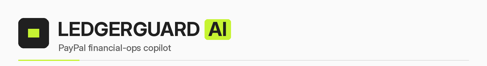

An agentic PayPal copilot for freelancers and cross-border micro-SMEs. It chases late invoices, builds chargeback defenses, and answers "who owes me what?" in plain language. The model proposes; code bounds it; a human approves every step that leaves the app.

Built by Chrisben Evans Leo (Nairobi) for the PayPal AI Hackathon, 2026. Built during the hackathon submission period (October 2026). Live demo: https://ledgerguard-web.onrender.com (app at [/app](https://ledgerguard-web.onrender.com/app)). API: https://ledgerguard-api-i7i3.onrender.com. Code: https://github.com/Chrisleo-16/ledgerguard-ai. Video: https://youtu.be/8JtWZxMUFTk.

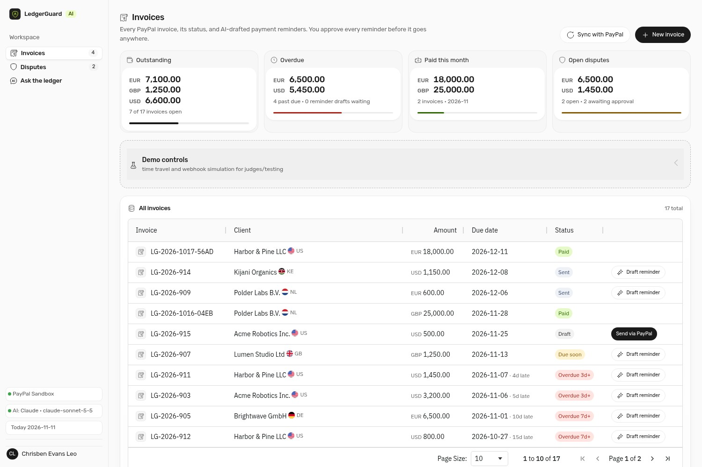

## Why LedgerGuard

Other tools either chase invoices or fight disputes. LedgerGuard is the only one that uses your invoice trail to win the dispute, built natively on PayPal.

1. All three jobs (invoice chasing, dispute defense, a conversational ledger) in one PayPal-native app.
2. Dispute evidence built from the invoice and reminder history, not just order data.
3. Guardrails enforced in code (fee caps, human approval), made for cross-border freelancers in markets like Kenya.

## Judge access

- Landing: https://ledgerguard-web.onrender.com · Demo app: https://ledgerguard-web.onrender.com/app · API: https://ledgerguard-api-i7i3.onrender.com (OpenAPI docs at `/docs`).
- No login needed. `/login` is a demo screen; "Continue to demo" opens the app.
- Both services run on Render's free plan and sleep when idle. The first request can take about a minute while they wake; reload if the app shows "API offline".
- The hosted demo runs in PayPal Sandbox mode. The sidebar shows **PayPal Sandbox**.
- The demo uses SQLite on an ephemeral disk and re-seeds its demo data on every boot, so changes you make are reset after a restart.
- Step-by-step test instructions are in [How to test it (judges)](#how-to-test-it-judges) below.

## How to test it (judges)

The hosted demo runs on Render's free plan. The first request can take about a minute while the services wake. Demo data resets when the service restarts, so invoices you create may disappear after a restart.

### A. Quick test (no PayPal account needed)

1. Open https://ledgerguard-web.onrender.com/app. Wait up to a minute if the service is waking, and reload if the app shows "API offline".
2. On an overdue invoice, click **Draft reminder** and read the reasoning beside the draft.
3. Open **Disputes** and look at a defense package with cited evidence. You do not need to submit it.
4. Open **Ask the ledger**, ask `past-due invoices over $1000`, and check that the table and the summary match the question.
5. Under **Demo controls**, move the clock forward and watch invoice statuses change.

### B. Full PayPal sandbox payment test (needs a free PayPal developer account)

1. Confirm the sidebar shows **PayPal Sandbox**.
2. Click **New invoice**, pick any client, enter a small amount such as 50 USD, then create and send it. LedgerGuard creates and sends a real PayPal sandbox invoice.
3. Copy the PayPal invoice id from the success toast. The toast reads like `Invoice LG-… created and sent (PayPal INV2-…)`. The invoice table shows only the LedgerGuard number (for example LG-2026-1016-04EB), not the PayPal INV2 id, so copy the INV2 id from the toast before it disappears (it stays for a few seconds).
4. Open the pay link `https://www.sandbox.paypal.com/invoice/p/#<INV2 id>`, replacing `<INV2 id>` with the id you copied.
5. Sign in with a sandbox **Personal** account and pay the invoice. You can create a Personal sandbox account for free in the [PayPal Developer Dashboard](https://developer.paypal.com/dashboard/accounts) under **Testing Tools > Sandbox Accounts**. Anyone with a Personal sandbox account can pay the invoice; you do not need the app owner's Business sandbox login.
6. Back in LedgerGuard, click **Sync with PayPal**. The invoice should turn Paid.

A walkthrough with screenshots of a real sandbox payment is in [Proof: a real PayPal sandbox payment](#proof-a-real-paypal-sandbox-payment).

## Proof: a real PayPal sandbox payment

On 11 Nov 2026 the hosted app in PayPal Sandbox mode created and sent this invoice, a sandbox buyer paid it on PayPal's own page, and LedgerGuard marked it Paid after Sync with PayPal.

1. LedgerGuard, running in PayPal Sandbox mode, created and sent invoice LG-2026-1017-56AD for EUR 18,000 to Harbor & Pine, and the toast shows PayPal invoice INV2-ZTWF-CPQH-YLWP-JAEC.

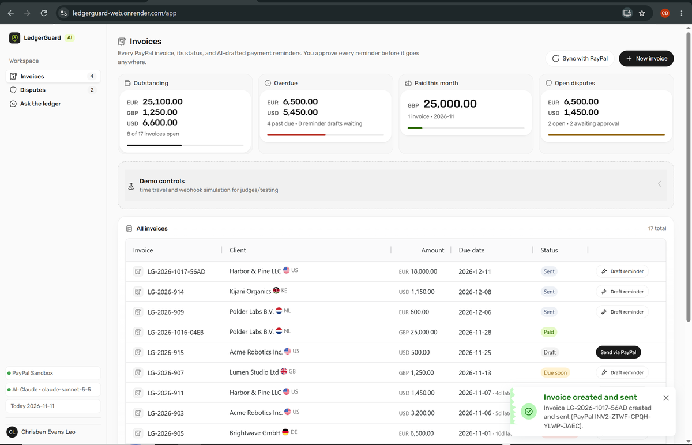

2. The PayPal sandbox pay page for that invoice shows EUR 18,000 due.

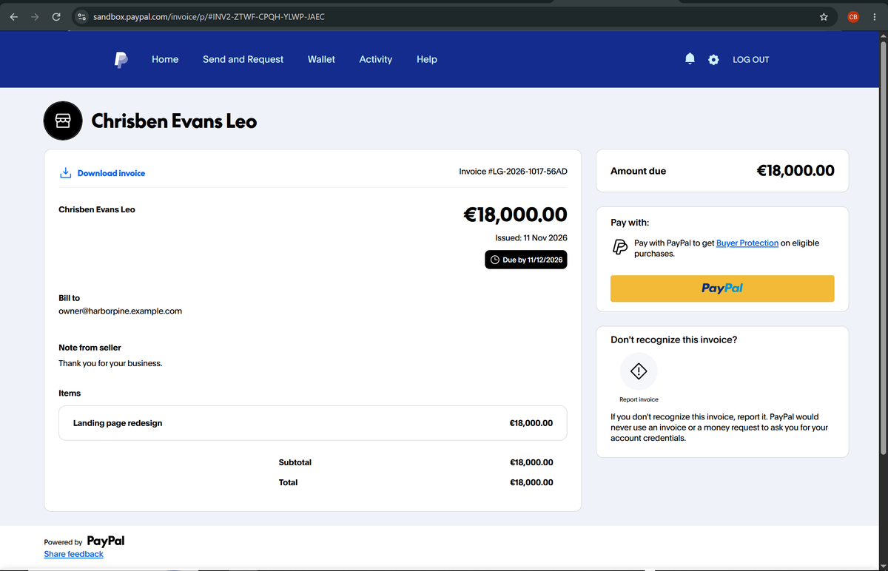

3. The buyer signs in to PayPal as a sandbox personal account.

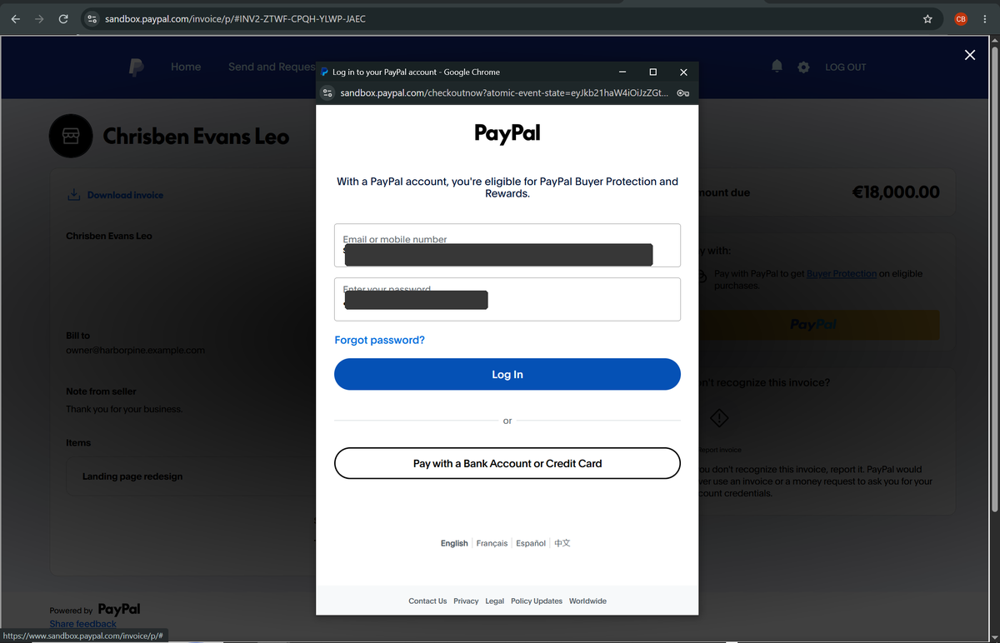

4. The PayPal checkout asks the buyer to complete the purchase of EUR 18,000.

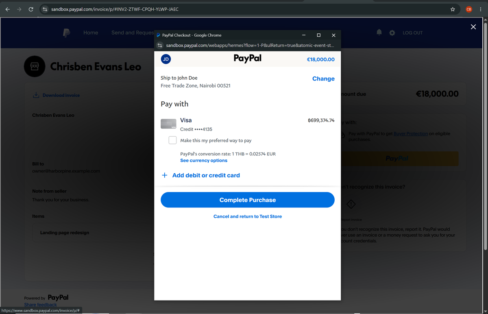

5. PayPal shows a processing screen that reads "Thanks for using PayPal".

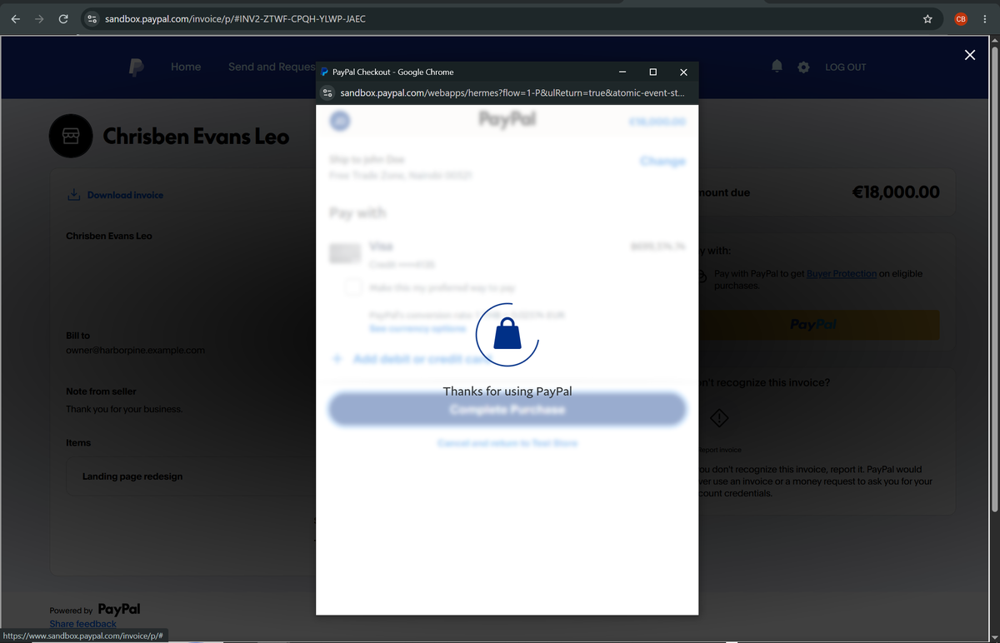

6. PayPal confirms the payment was successful and that the buyer paid EUR 18,000.00.

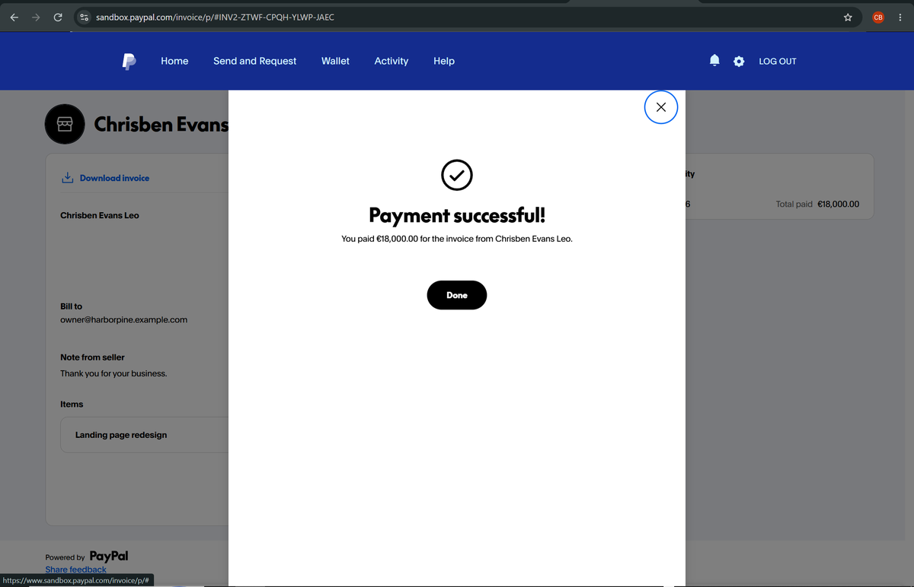

7. The same invoice page now shows Paid, with EUR 0.00 due.

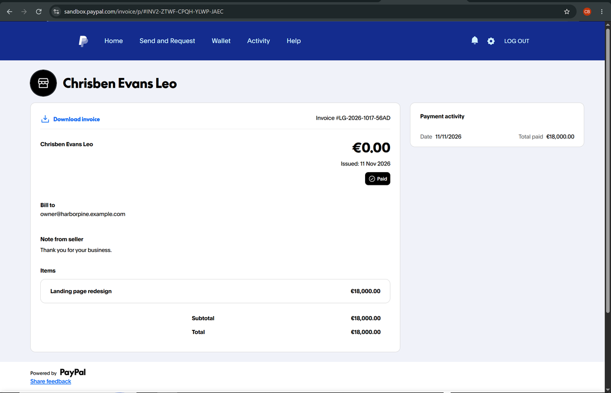

8. The PayPal business Invoicing list shows both LG-2026-1017-56AD and LG-2026-1016-04EB as Paid.

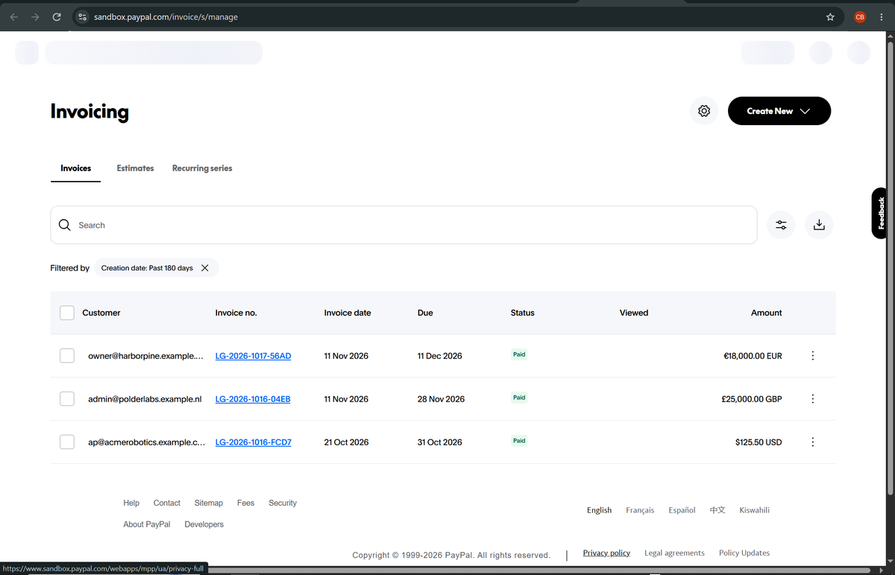

9. After Sync with PayPal, LedgerGuard marks LG-2026-1017-56AD as Paid, and Paid this month shows EUR 18,000 and GBP 25,000.

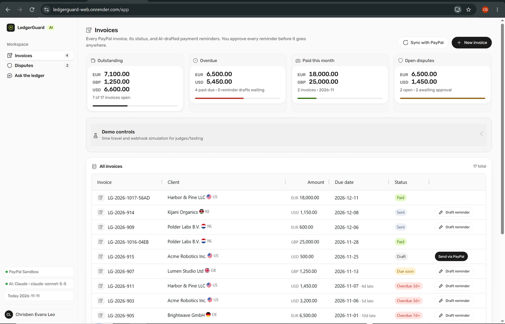

## Behaviour

Three workflows share one invoice ledger.

**Invoice chaser.** Invoices move through a state machine: `draft → sent → due_soon → due → overdue_3 → overdue_7 → paid`. A LangGraph agent reads the client's country, payment history, message sentiment, and prior reminders. Claude picks the next action (wait, remind, offer a split, offer Pay Later, escalate), the tone, and a late fee. Code then applies the guardrails and writes a draft. Drafts are never sent.

**Dispute defense.** A `CUSTOMER.DISPUTE.CREATED` event triggers evidence search, a timeline, milestone refs, and a statement that cites evidence ids. Claude ranks evidence by relevance and flags gaps. Evidence reaches PayPal only after you click Approve.

**Conversational ledger.** A question becomes a JSON filter spec. The server validates it against an allow-list. The LLM never writes SQL. Totals are computed exactly from matching rows, per currency.

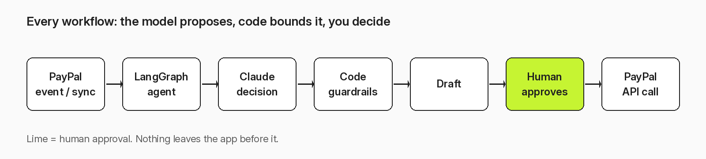

## Agents

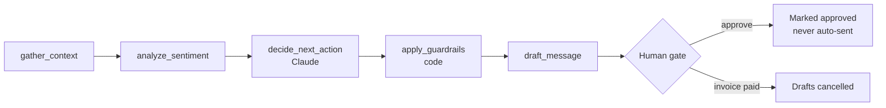

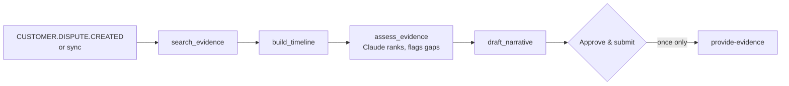

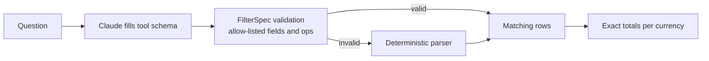

With `ANTHROPIC_API_KEY` set, Claude runs through the `anthropic` SDK (`LLM_MODEL`, default `claude-sonnet-5-5`). Otherwise an OpenAI-compatible endpoint is used. With no key, a deterministic rules engine runs. Every structured result is validated again on the server.

## Layout

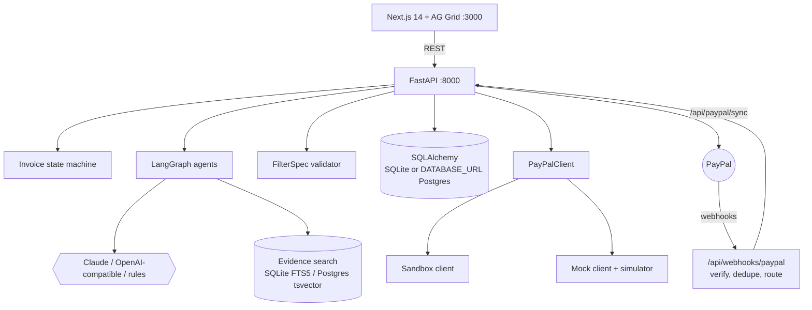

| Path | Role |
|---|---|
| `backend/app/main.py` | FastAPI routes, webhooks, sync, dev clock and simulators |
| `backend/app/agents.py` | LangGraph reminder and dispute agents, guardrails |
| `backend/app/llm.py` | Claude, OpenAI-compatible, or deterministic provider |
| `backend/app/paypal.py` | sandbox and mock PayPal clients, token cache, backoff |
| `backend/app/state_machine.py` | invoice lifecycle states |
| `backend/app/filters.py` | FilterSpec allow-list and exact totals |
| `backend/app/evidence_search.py` | FTS5 / tsvector evidence search |
| `backend/app/db.py`, `seed.py` | SQLAlchemy models, demo data |
| `backend/tests/` | state machine, filters, guardrails, webhooks, PayPal client |
| `frontend/app/` | `/` landing, `/how-it-works`, `/login` (demo), `/app` chaser, `/disputes`, `/ledger` |
| `frontend/public/` | PWA manifest, service worker (app shell only), icons |
| `frontend/components/` | AG Grid, nav, UI kit |
| `render.yaml` | two-service Render blueprint |
| `docs/` | Devpost write-up, demo script, README assets |

## Screens

These screenshots were taken from the live demo at https://ledgerguard-web.onrender.com on 11 November 2026.

Landing page. Get Started opens the demo; no account is required:

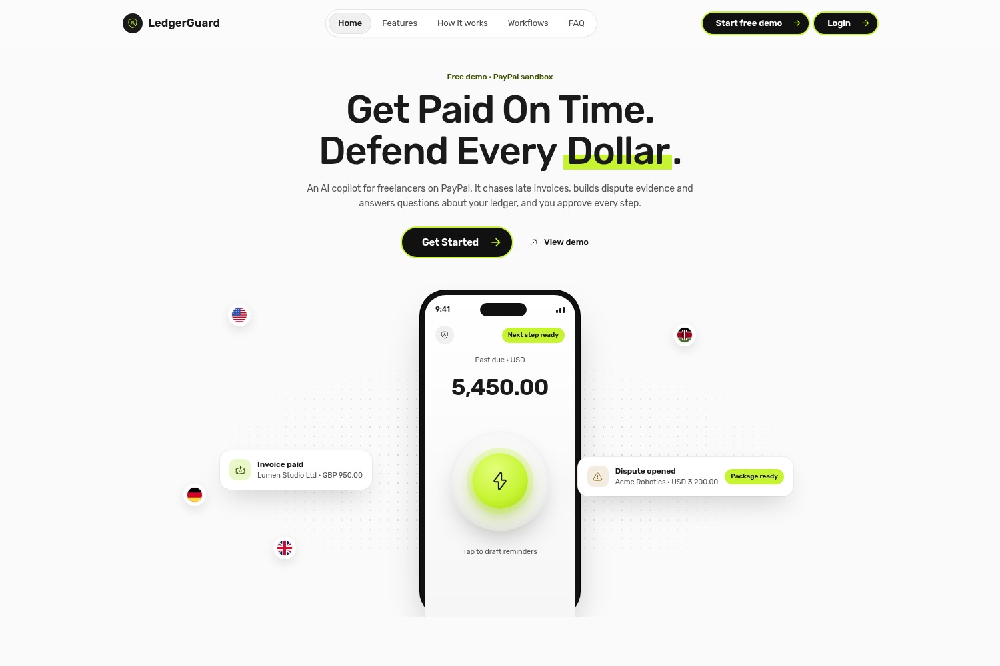

How the AI works: what Claude decides and what code enforces:

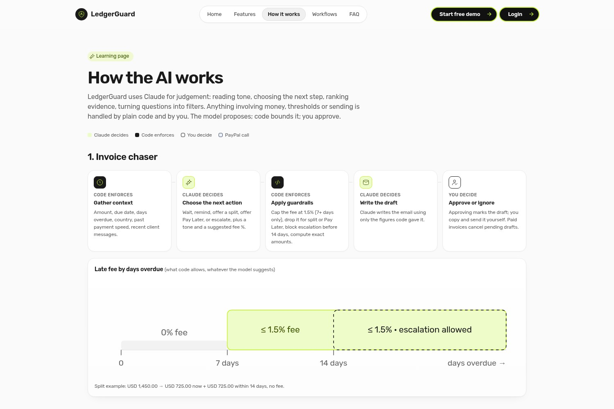

Invoice dashboard with outstanding, overdue, paid and dispute totals, plus the live invoice grid:


Invoice grid and reminder drafts. Claude can recommend waiting, and you approve every reminder before it is sent:

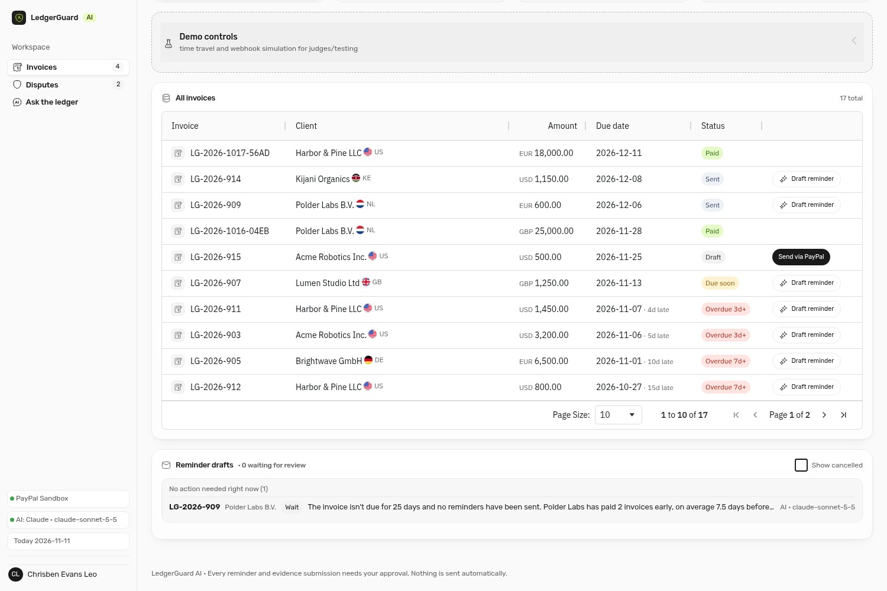

Dispute defense with an evidence timeline and Claude's cited review, waiting for your approval:

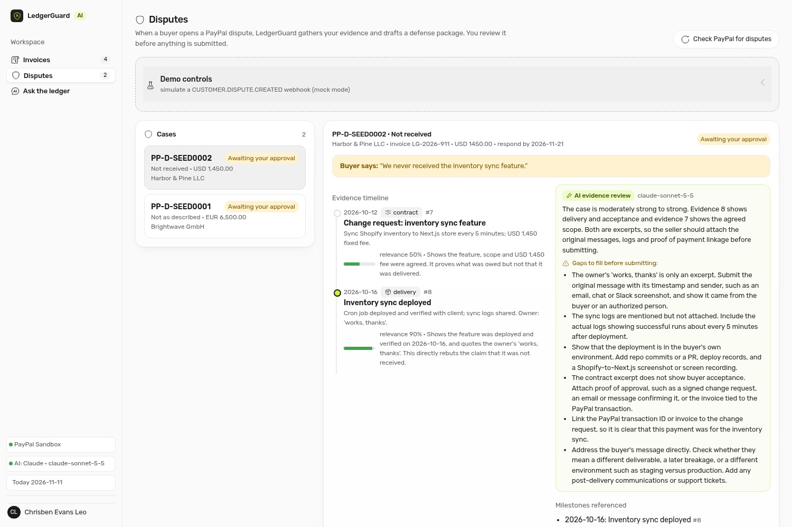

Ask the ledger: a plain-English question, a checked filter, and the exact matching invoices:

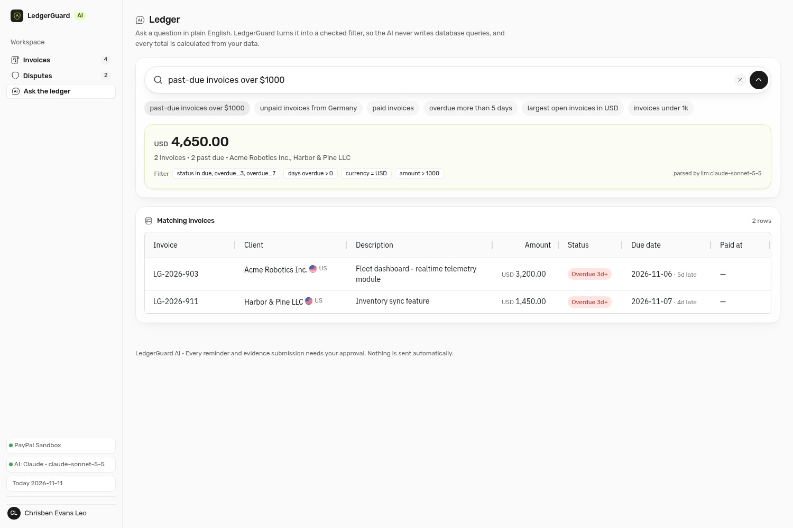

## Local

Python 3.11+ and Node 20+. Mock mode needs no credentials.

```bash
cp .env.example .env
./run-backend.sh     # venv, seed, http://localhost:8000 (docs at /docs)
./run-frontend.sh    # http://localhost:3000 (landing), /app for the demo
./run-tests.sh       # 32 tests
```

Reset the demo data:

```bash
cd backend && .venv/bin/python -m app.seed
```

Time travel and simulation in mock mode:

```bash
curl -X POST localhost:8000/api/dev/clock/advance -H 'content-type: application/json' -d '{"days":7}'
curl -X POST localhost:8000/api/reminders/run
curl -X POST localhost:8000/api/ledger/query -H 'content-type: application/json' -d '{"question":"past-due invoices over $1000"}'
```

## PayPal

Sandbox mode turns on when `PAYPAL_CLIENT_ID` and `PAYPAL_CLIENT_SECRET` are both set. `PAYPAL_MODE=mock|sandbox` forces one.

| Surface | Calls |
|---|---|
| Invoicing v2 | `POST /v2/invoicing/invoices`, `POST /v2/invoicing/invoices/{id}/send`, `GET /v2/invoicing/invoices/{id}` |
| Disputes | `GET /v1/customer/disputes`, `GET /v1/customer/disputes/{id}`, `POST /v1/customer/disputes/{id}/provide-evidence` |
| Webhooks | `INVOICING.INVOICE.PAID`, `PAYMENT.CAPTURE.COMPLETED`, `CUSTOMER.DISPUTE.CREATED` |
| Verification | `POST /v1/notifications/verify-webhook-signature`, de-dupe by event id |

OAuth2 tokens are cached. 429 and 5xx retry with exponential backoff and jitter, honouring `Retry-After`. Writes carry a `PayPal-Request-Id` idempotency key.

No public URL? `POST /api/paypal/sync` polls open invoices. `PAID` or `MARKED_AS_PAID` goes through the same mark-paid path as the webhook and cancels pending drafts. New disputes get a defense package.

Deploy: Render → New → Blueprint. `render.yaml` creates `ledgerguard-api` and `ledgerguard-web`; secrets are prompted, never committed. Default is `PAYPAL_MODE=mock`.

## Rules

1. Nothing is sent without human approval. Reminders are drafts only.
2. Dispute evidence goes to PayPal only from the approval endpoint, once.
3. Late fee is capped at 1.5% and only from 7+ days overdue.
4. The fee is dropped when a split or Pay Later is offered.
5. Fee amounts are computed by code, never by the model.
6. Escalation is allowed only from 14+ days overdue.
7. Before the due date: no firm tone, plain reminder only.
8. Split installments are exact and sum to the invoice total.
9. A draft mentioning a fee the policy disallowed is replaced with a template.
10. Evidence ids must exist; relevance scores are clamped to 0–1.
11. Ledger questions become a validated JSON filter, never SQL. Numbers are never generated by the LLM.

## Not yet

- Login is a demo screen only: no accounts, no passwords. The PWA caches the app shell, never API data, so offline it shows the shell without live numbers.
- Webhooks against a public URL: not yet exercised end to end. Sync polling is the tested path.
- Buyer payment of an invoice in the PayPal sandbox is verified (see below). Live disputes in the sandbox remain untested.
- Docker (`docker compose up --build`) and Postgres via `DATABASE_URL`: untested.
- Render free plan uses SQLite on an ephemeral disk; the demo re-seeds on every boot.
- Seeded invoices carry synthetic PayPal ids; live sandbox calls need new invoices.

**Verified live.** On 11 Nov 2026 the hosted app ran in PayPal Sandbox mode (the sidebar shows **PayPal Sandbox**). A sandbox personal buyer paid two invoices on PayPal's own page, and LedgerGuard marked both Paid after Sync with PayPal: LG-2026-1016-04EB (PayPal INV2-GRCS-7EKA-KPLM-47R3, GBP 25,000) and LG-2026-1017-56AD (PayPal INV2-ZTWF-CPQH-YLWP-JAEC, EUR 18,000). Screenshots of the second payment are in [Proof: a real PayPal sandbox payment](#proof-a-real-paypal-sandbox-payment).

## Docs

- [Devpost write-up](docs/DEVPOST.md)
- [Demo script](docs/DEMO_SCRIPT.md)
- [Render blueprint](render.yaml)
- [Environment template](.env.example)
- API docs: `http://localhost:8000/docs`

MIT © 2026 Chrisben Evans Leo. See [LICENSE](LICENSE).

UI credits: status toasts adapted from Uiverse.io by akshat-patel28 and the cookie card from Uiverse.io by ilkhoeri, the workflow cards from Uiverse.io by satyamchaudharydev, and the animated CTA button from Uiverse.io by gharsh11032000, the download button from Uiverse.io by sahilxkhadka, the animated checkbox from Uiverse.io by SelfMadeSystem (all MIT). See [THIRD_PARTY_NOTICES.md](THIRD_PARTY_NOTICES.md).
